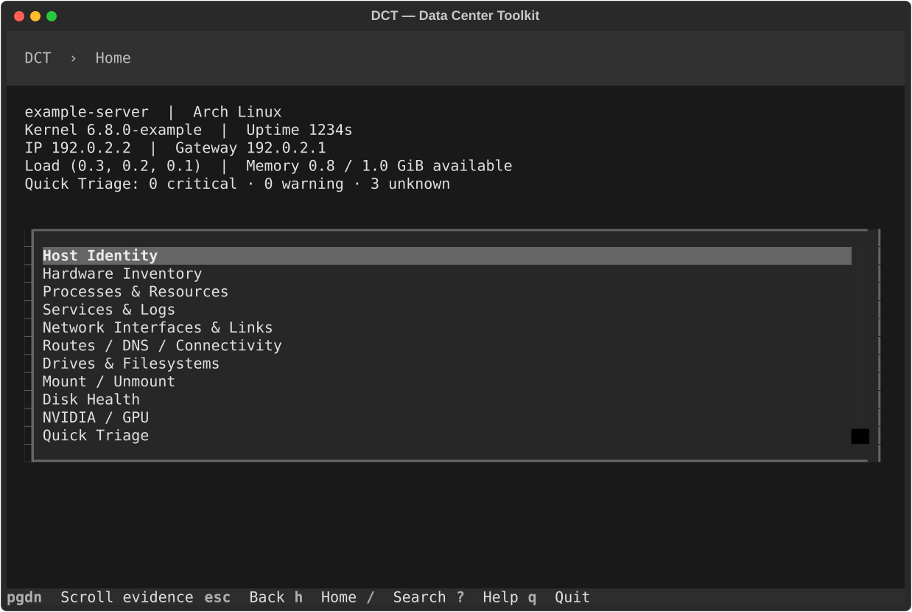

# DCT — Data Center Toolkit

An evidence-first Linux TUI for data center technicians.

Inspect hosts, troubleshoot services and networking, manage local storage,
diagnose GPU systems, inspect remote Linux hosts over OpenSSH, and generate
incident evidence without memorizing dozens of commands.



**Logs before levers. Evidence before action.**

DCT v0.1.0 is a public release candidate for founder review. It does not claim
enterprise production readiness. Qualification evidence and limitations are in
[verification](docs/verification.md) and [platform support](docs/platform-support.md).

## What you can inspect

- Host identity, Linux/kernel version, uptime and time synchronization.
- CPU, memory, swap, pressure, cgroups and process details.
- systemd service state, dependencies and selected recent warning journals.
- Interfaces, addresses, routes, neighbors, DNS configuration and listeners.
- Drives, filesystems, capacity and available SMART/NVMe health.
- NVIDIA telemetry, VRAM, ECC and compute-process ownership.
- Quick Triage findings with evidence, failure domain, confidence and next steps.
- One remote Linux host through your existing OpenSSH setup.
- Sanitized incident evidence bundles written locally.

Missing commands, denied permissions and incomplete telemetry remain **UNKNOWN**.
Unavailable NVIDIA tooling is a capability gap. Resolver configuration alone does
not prove DNS works. Diagnostics never perform a recommended repair automatically.

## Install

Linux and Python **3.11 or newer** are required. Install the built wheel in an
isolated environment; sudo is unnecessary:

```sh
python3 -m venv .venv
. .venv/bin/activate
python -m pip install dist/data_center_toolkit-0.1.0-py3-none-any.whl
dct
```

From a source checkout, use `python -m pip install .`. Optional host tools include
`ip`, `ss`, `ps`, `lsblk`, `findmnt`, `df`, `systemctl`, `journalctl`, `timedatectl`,
`resolvectl`, `smartctl`, `nvme` and `nvidia-smi`. Remote inspection additionally
requires the system `ssh` command locally and ordinary inspection tools remotely.
DCT installs no agent or utilities on the inspected host.

## Quick start: localhost

```sh
dct
```

Home immediately inspects localhost. Open Host Identity, Resources or Quick Triage;
use `/` to find a task. The target indicator stays visible as you navigate.

| Key | Action |
| --- | --- |
| Up/Down or Tab | Navigate |
| Enter | Open/select |
| Esc | One screen back; Home stays Home |
| h | Home |
| / | Search tasks |
| t | Change Target; inventory and session recents |
| ? | Contextual help |
| q | Quit |

Text inputs consume letters while typing. Collection runs in workers so navigation
stays responsive. Long inventories and detailed evidence scroll.

## Remote usage

Choose Change Target to browse inventory, search hostnames, addresses or tags, and
select one host. Or launch directly:

```sh
dct --host example-server
dct --host technician@server.example.com
dct --inventory hosts.yaml --host gpu-042
```

An OpenSSH alias uses your existing `~/.ssh/config`, keys, certificates, ssh-agent,
known_hosts and enterprise authentication. Configure them outside DCT. For example:

```sshconfig
Host example-bastion
    HostName bastion.example.com
    User technician

Host example-server
    HostName server.example.com
    User technician
    ProxyJump example-bastion
```

DCT uses noninteractive SSH and requires an already trusted host key. It never
accepts an unknown key, weakens host-key verification, asks for passwords, stores
credentials or modifies SSH configuration. Establish approved SSH access outside
DCT first. Use approved SSH configuration; custom proxy programs and Match exec
remain trusted user-owned configuration. A failed connection becomes explicit evidence rather than a healthy host.
Remote headers show **REMOTE**, the selected target and address. Remote inspection
is read only; mount/unmount is rejected. v0.1.0 selects one target at a time.

## Target inventory

Localhost is always available. Concrete aliases can be discovered from OpenSSH
config; wildcard-only entries are not expanded into hosts. A user-owned YAML file
can provide explicit targets:

```yaml
hosts:
  - name: gpu-042
    address: 192.0.2.42
    user: technician
    port: 22
    tags:
      site: example-site
      rack: B07
      role: gpu
```

Keep inventories private if they describe real infrastructure. Inventories contain
connection identity and descriptive metadata, never passwords or private keys.
See [architecture](docs/architecture.md) for provider boundaries and
[future inventory design](docs/future-inventory.md) for fleet and source-of-truth plans.
NetBox, Nautobot and bulk execution are **not implemented** in v0.1.0.

## Safety and troubleshooting

Inspection does not escalate privileges. Read evidence before proposing a change:
findings distinguish observation, inference, confidence and the next useful check.
Read [the troubleshooting model](docs/troubleshooting-model.md).

Local storage is the only state-changing workflow. An individually confirmed,
revalidated mount/unmount proposal can use existing noninteractive authorization.
Mounts use `ro,nodev,nosuid,noexec`, but read-only mounting can replay filesystem
journals. System/nested mounts, ambiguous identity and stale proposals are refused.
No forced/lazy unmount, process killing, service restart or GPU reset is available.
Read [the safety model](docs/safety.md) before administrative use.

## Reports and screenshots

Incident bundles include normalized evidence, a technician summary and a SHA-256
manifest. Raw command output, journals and credential material are excluded.
Reports retain evidence target attribution; review identifying target information
and remaining hardware details before sharing. See [incident reports](docs/incident-reports.md).

All public screenshots use synthetic evidence:

| Screen | Preview |
| --- | --- |
| Quick Triage | [triage.svg](docs/screenshots/triage.svg) |
| Host Identity | [identity.svg](docs/screenshots/identity.svg) |
| Resources | [resources.svg](docs/screenshots/resources.svg) |
| Services | [services.svg](docs/screenshots/services.svg) |
| Network | [network.svg](docs/screenshots/network.svg) |
| Storage | [storage.svg](docs/screenshots/storage.svg) |
| NVIDIA GPU | [gpu.svg](docs/screenshots/gpu.svg) |
| Remote indicator | [remote.svg](docs/screenshots/remote.svg) |
| Incident summary | [incident.svg](docs/screenshots/incident.svg) |

Run the synthetic demo from a checkout:

```sh
python -m dct --fixture tests/fixtures/release/arch_gpu_workstation.json
```

See [demo instructions](docs/demo.md) for report examples, screenshot generation
and optional local asciinema recording.

## Platforms, architecture and roadmap

**TESTED:** deterministic Linux fixture scenarios and recorded actual-host runs in
[verification](docs/verification.md). **DESIGNED TO SUPPORT:** RHEL, Rocky Linux,
AlmaLinux, CentOS Stream, Ubuntu, Debian and Arch through capability detection.
**NOT YET QUALIFIED:** any distribution/version or hardware configuration without
an actual recorded run. Synthetic fixtures are not distribution certification.

The shared pipeline is InventoryProvider → Target → Executor → Collectors →
Normalized Evidence → Diagnostics → TUI/Reports. Local, SSH and fixture execution
share collectors and diagnostics. Read [architecture](docs/architecture.md).

Future work may add inventory adapters, expected-versus-observed drift reporting
and explicitly bounded fleet collection. These are design directions, not current
capabilities. No source-of-truth mutation or bulk host operations are implemented.
See [CHANGELOG](CHANGELOG.md) for the v0.1.0 scope.

## Contributing

Use synthetic fixtures and preserve UNKNOWN states and safety boundaries. Explain
the observed problem, reproduction, expected behavior and verification in a change.
Never attach private infrastructure output, credentials or identifying screenshots.

```sh
python -m pip install -e '.[dev]'
pytest
ruff check .
ruff format --check .
mypy --strict src
python -m build --no-isolation
```

Use injected executors for deterministic tests. Live qualification is read only;
local mount/unmount tests must use fakes. Substantial changes require independent
code, safety and UX review. See [release plan](docs/release-plan.md).

## License

[MIT](LICENSE), copyright DCT contributors.
